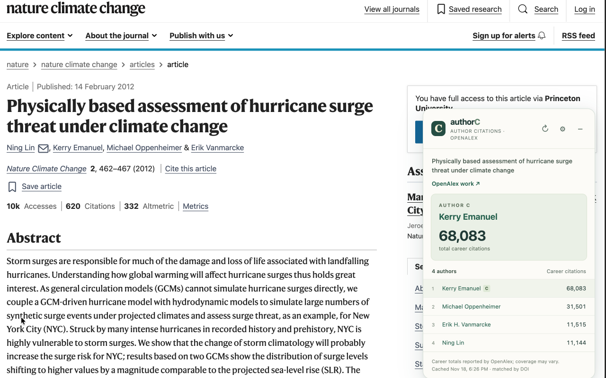
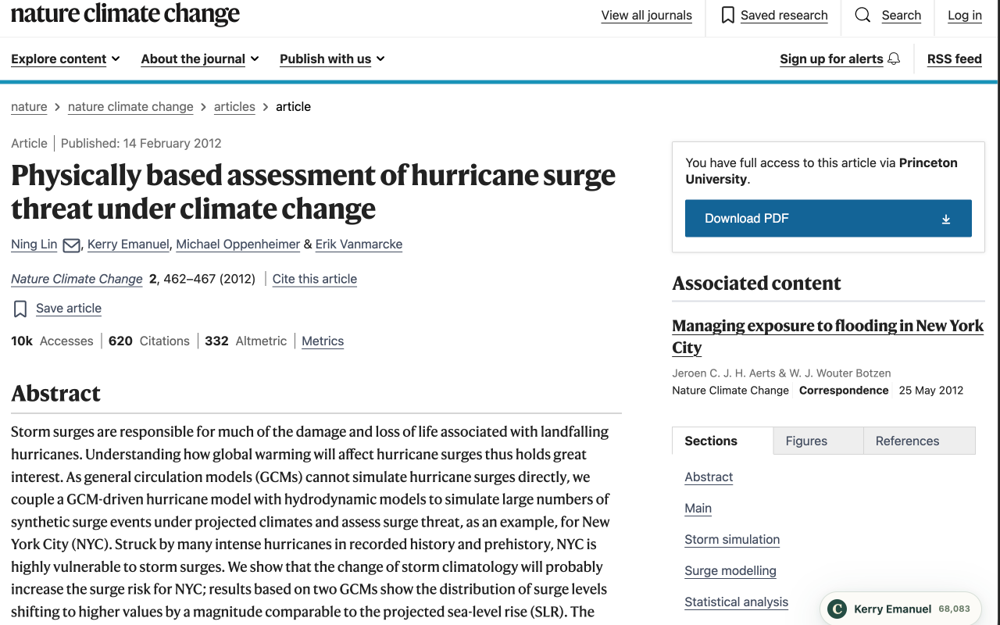

# authorC

See a research article’s authors ranked by **total career citations** while reading it on the publisher’s website.

authorC finds the matching OpenAlex work, displays each available author’s citation total, and highlights the highest-cited author as **Author C**. Minimize the panel to keep the leading author’s name and count visible alongside the article.

## Install

1. [Download authorC](https://github.com/CongGao-CG/authorC/archive/refs/heads/main.zip) and extract the ZIP.
2. Open `chrome://extensions` in Chrome and enable **Developer mode**.
3. Select **Load unpacked** and choose the extracted `authorC-main` folder containing `manifest.json`.
4. In authorC’s settings, read the data-use notice and select **Agree and enable automatic lookups**.
5. Open a research article, or reload an article tab that was already open.

No build step or package installation is needed. Settings opens on first installation; it is also available through the extension’s **Options** menu.

## Use

The panel appears automatically when authorC identifies an article from its metadata or a supported publisher URL.

- **Author C** identifies the highest available career citation total. Tied authors share the label.
- The author list is ordered from highest to lowest citation count. Missing counts are shown as unavailable.
- **OpenAlex work** opens the matched article record. Author names link to available OpenAlex profiles.
- **Minimize** collapses the panel to the leading author’s name and count. Click the pill or the extension icon to expand it.
- **↻** fetches fresh counts. Complete results are otherwise reused locally for up to 24 hours.
- **Pause automatic lookups** in Options stops detection and requests and clears cached article results.

## Example article

Try authorC on [Physically based assessment of hurricane surge threat under climate change](https://www.nature.com/articles/nclimate1389), by Ning Lin, Kerry Emanuel, Michael Oppenheimer, and Erik Vanmarcke, published in *Nature Climate Change* in 2012.

The panel compares the authors’ career citation totals from OpenAlex. These totals change as OpenAlex updates its records.

## Screenshots

**Full author ranking**

**Compact view — leading author’s name and citation count**

Citation totals shown in screenshots can change as OpenAlex updates its records.

## Optional OpenAlex API key

Basic lookups can run without a key. If OpenAlex reports a request limit, an optional personal API key can provide a higher allowance. See [OpenAlex API access](https://help.openalex.org/api/authentication/).

Open authorC’s **Options**, enter your key, and save. The key is stored locally in this browser’s extension storage and sent only to OpenAlex; it is not synced through Chrome Sync or shown to the publisher page. Clear the field and save to remove it. Pausing lookups keeps the saved key.

## Understanding the results

Counts represent citations across each author’s publications indexed by OpenAlex. They are **career totals**, not citations to the article being viewed. Coverage and author identification depend on OpenAlex, so totals may differ from other services.

authorC prefers an exact DOI lookup. When no DOI is available, it can use scholarly title and author metadata; ambiguous matches are rejected. It does not search reference lists for an article identifier.

Some publishers expose insufficient metadata, and new articles or authors may not yet be indexed. Large author lists may be incomplete; the panel indicates missing or truncated data. Chrome’s internal pages and built-in PDF viewer are not supported.

## Privacy

Automatic detection starts only after you enable it. Article metadata and the current page URL are checked locally. A detected DOI or title, followed by OpenAlex work and author IDs, is sent to OpenAlex to retrieve rankings. These identifiers reveal which article is being looked up. OpenAlex also receives your network IP address and any optional API key.

authorC does not upload full articles, cookies, or a complete browsing history. It has no analytics service or separate authorC server. You can pause lookups, clear cached results, or remove your saved key in Options.

Read the [privacy policy](https://conggao-cg.github.io/authorC/privacy.html) for details about storage, sharing, and controls.

## Help

If the panel does not appear, confirm that automatic lookups are enabled and reload the article page. If you have updated the downloaded extension, click **Reload** for authorC at `chrome://extensions`, then reload your article tabs.

Report a problem through [GitHub Issues](https://github.com/CongGao-CG/authorC/issues) or email [cnggao@gmail.com](mailto:cnggao@gmail.com). Include the article URL and any error message, but never an API key.

authorC is maintained by Cong Gao. It is an independent project, not an official OpenAlex or publisher product.
